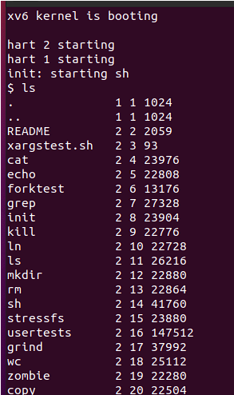

# Jerkll踩坑全纪录
## 基本思路

Jerkll的作用是用来搭建个人主页，他的最大优势是避免大量的html coding，从而提升整体的便捷程度。但是对于html本身就不熟悉的人来说，还有很多比较容易踩坑的地方

## Start：
我个人感觉官方文档写的也不太清楚。所以我比较推荐找一个简单简介的模板，避开复杂的css渲染，看他的源码。踩了这么多坑之后，感觉搭建主页的步骤大概如下 ：

### 1.复制模板，这一步没必要自己做，因为很多配置文件，Gemfile等都可以直接用模板的

### 2.确定好文件架构，一般的模板的文件架构大概是：


其中index html是一打开页面就有的那个页面，然后他通过超链接检索到不同的子页面，

不同的文件分别是：
assets：存放文件

Gemfile、config、gemspec：官方文件，规定渲染等

include：包含定义结构的头文件

layout：定义版面的html文件

其余：根据个人需求建立的子文件夹，

我的推荐配置是，创建一个md放在include里面，md便于编辑，然后创建一个index html放在对应的文件夹中，类似：
```python
├── _includes
│   ├── comments.html
│   ├── header.html
│   ├── home.md
│   └── publications.md
├── publications
│   └── index.html
```

md正常写就可以

### 3.坑：

#### 3.1：图片显示不出,github只会支持根目录，我原来使用相对目录的md语法，插入图片不行：
```python

```

html也不行：
```html

```

上述两种方法在本地和github仓库内都能显示，但是在.io主页不能，改为：

```html

```

#### 3.2: post的命名规则
必须按照20xx-xx-xx-name.md命名，而且必须有：
```python
---
layout: post
title: "Jerkll Mistake Record"
date: 2024-11-21
---
```
来规定版面
